# KrishiVision — Crop Health Intelligence

Identify crop disease signs from leaf images, estimate how severe the damage is, and get prevention guidance suited to Kolhapur and Western Maharashtra.


## What it does

| Feature | How it works |
|---|---|
| Leaf image input | Upload or capture a photo, or use a built-in sample leaf. Everything runs in the browser; photos are never uploaded. |
| Damage detection | Pixels are segmented into background, healthy, yellowing, brown, dark and rust-coloured areas. Damaged areas are highlighted on the image. |
| Severity estimate | Share of leaf area damaged is graded Healthy (<1%), Mild (<10%), Moderate (<25%), Severe (<50%) or Critical. |
| Condition match | Lesion colour and spread are matched to a likely condition for the selected crop (sugarcane, rice, soybean, tomato). |
| Local guidance | Prevention steps, severity-based advice, and a Kharif / Rabi / Summer guide for Western Maharashtra. |

> **Limits.** This is a colour-and-spread screening tool, not a trained deep-learning model or a diagnosis. Similar-looking problems can be confused. Confirm with a Krishi Vigyan Kendra (KVK) or taluka agriculture officer before spraying. The analysis module (`js/analysis.js`) is isolated so a trained model (for example TensorFlow.js) can replace it later.

## Tech stack

HTML, CSS and vanilla JavaScript (no framework, no runtime dependencies) · Node.js `node:test` for unit tests · Docker + nginx · GitHub Actions (CI and Pages deploy).

## Run it

```bash
npm start            # http://localhost:8080  (no install needed)
npm test             # 7 unit tests
npm run check        # JavaScript syntax check
docker compose up -d --build   # http://localhost:8080 via nginx
```

## Project structure

```
index.html            page
css/style.css         styles (responsive, keyboard focus, reduced motion)
js/analysis.js        segmentation, severity grading, condition matching
js/knowledge.js       crop-specific conditions and prevention steps
js/app.js             uploader, sample leaves, overlay, result panel
tests/                unit tests
server.js             dependency-free static server for local use
Dockerfile, nginx.conf, docker-compose.yml
.github/workflows/    ci.yml (test + docker build + smoke test), pages.yml (deploy)
docs/screenshots/     project screenshots
```

## Commit history (progress)

| # | Commit | What changed |
|---|---|---|
| 1 | `chore: initialise KrishiVision project` | package.json, license, gitignore |
| 2 | `feat(ui): add landing page layout…` | page layout and styles |
| 3 | `feat(core): add leaf analysis engine…` | analysis engine, knowledge base, 7 unit tests |
| 4 | `feat(app): wire uploader, sample leaves…` | working analyzer with damage overlay |
| 5 | `ci: add GitHub Actions workflows…` | CI and Pages deployment |
| 6 | `build: containerise with nginx…` | Dockerfile, nginx, compose |
| 7+ | `docs: …` | screenshots and README |

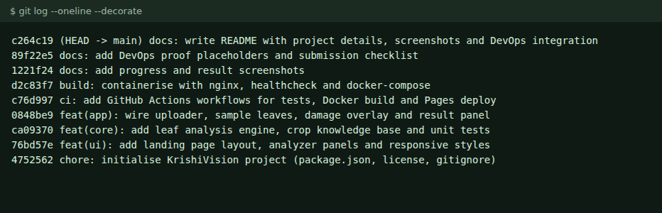

## Screenshots

### Progress: UI layout only (commit 2) → working analyzer (commit 4)

| Commit 2: static layout | Final: analyzer working |
|---|---|
| 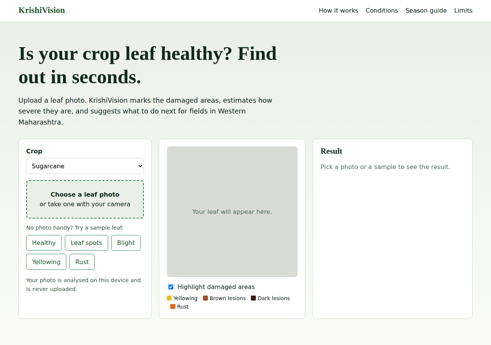 |  |

### Results for each sample leaf (sugarcane selected)

| Healthy | Leaf spots |
|---|---|
| 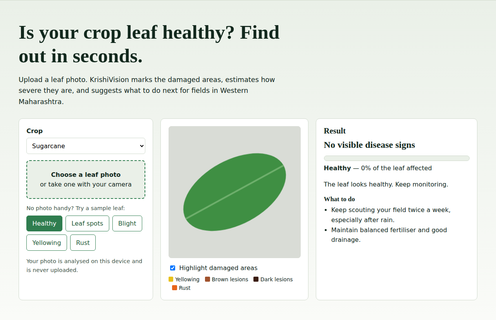 | 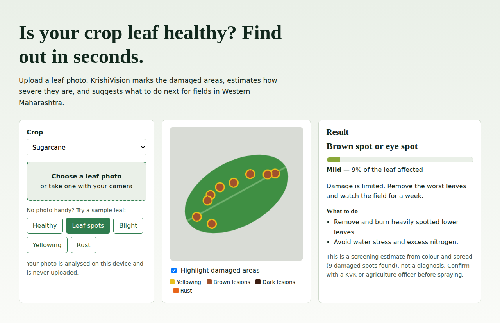 |
| **Blight** | **Yellowing** |
| 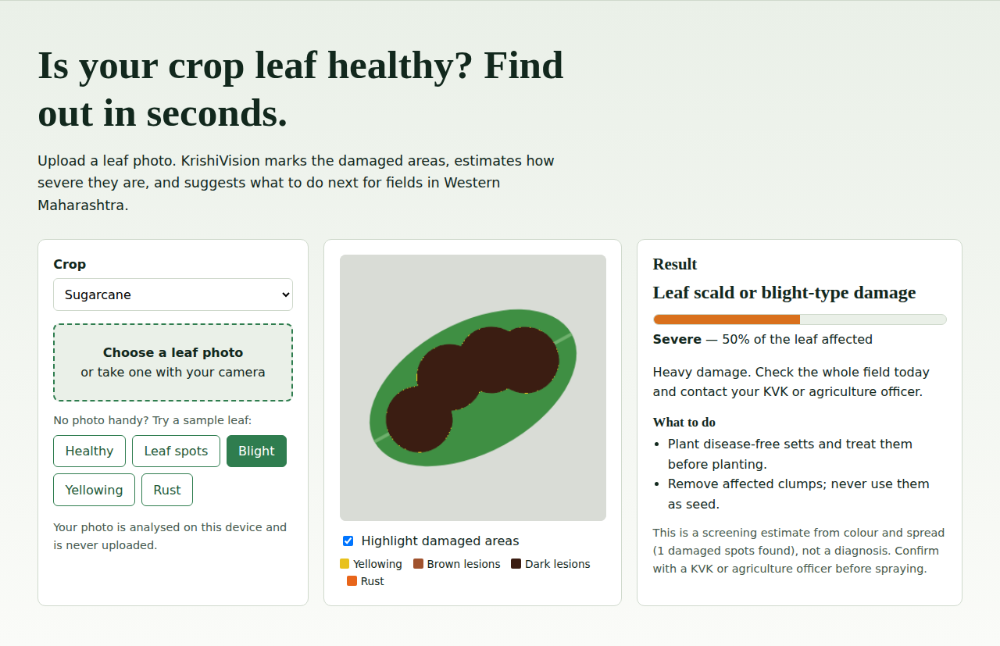 | 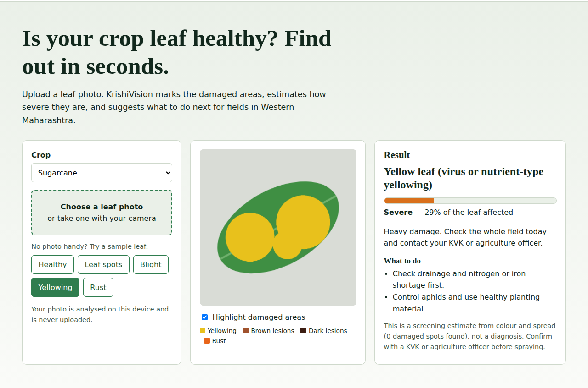 |
| **Rust** | **Same blight leaf, tomato selected (guidance changes with crop)** |
| 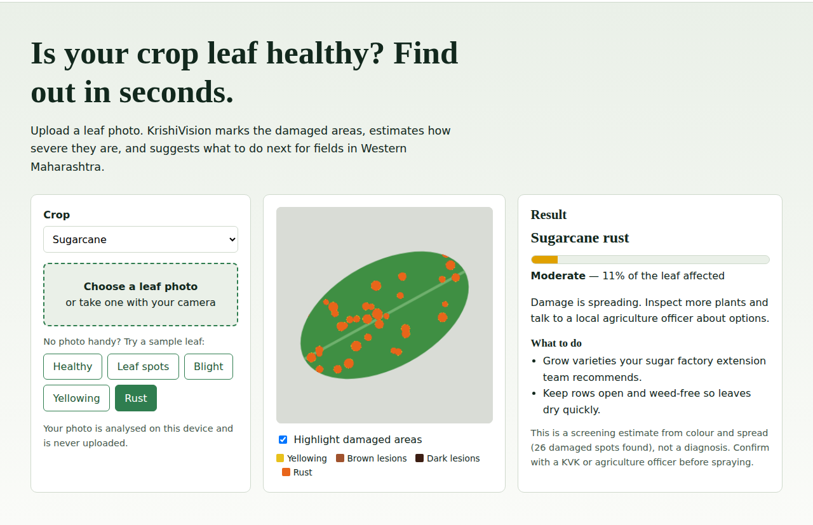 | 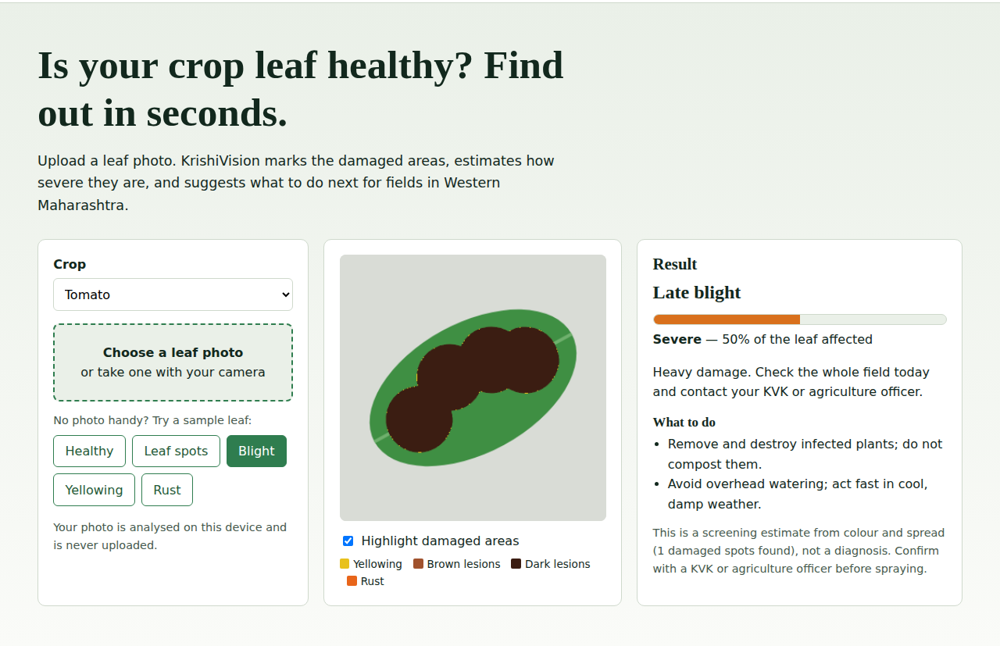 |

### Season guide and mobile view

| Season guide | Mobile |
|---|---|
| 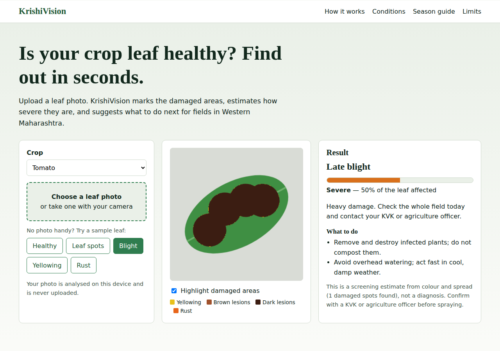 | 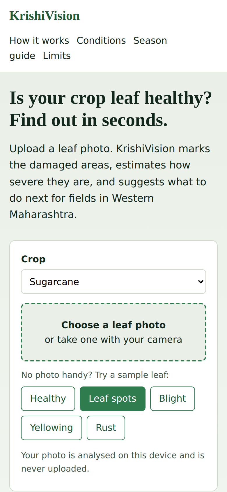 |

## DevOps tool integration

| Tool | Purpose | Files |
|---|---|---|
| **Git / GitHub** | Version control with 7+ small commits | `.git`, `.gitignore` |
| **GitHub Actions (CI)** | On every push/PR: syntax check, unit tests, Docker image build, container smoke test | `.github/workflows/ci.yml` |
| **GitHub Actions (CD)** | Deploys the site to GitHub Pages on push to `main` | `.github/workflows/pages.yml` |
| **Docker** | nginx image with healthcheck | `Dockerfile`, `nginx.conf`, `.dockerignore` |
| **Docker Compose** | One-command local run | `docker-compose.yml` |
| **Automated tests** | `node:test` unit tests run locally and in CI | `tests/analysis.test.js` |

**Unit tests passing (local run):**

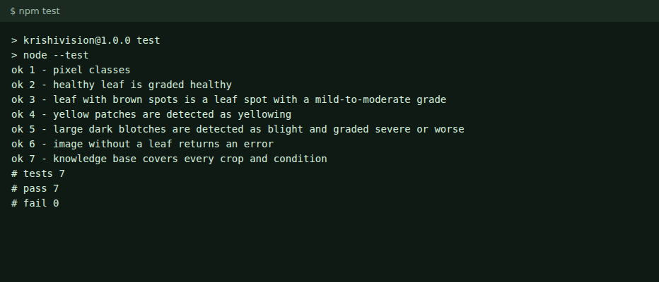

**CI pipeline run on GitHub Actions:**

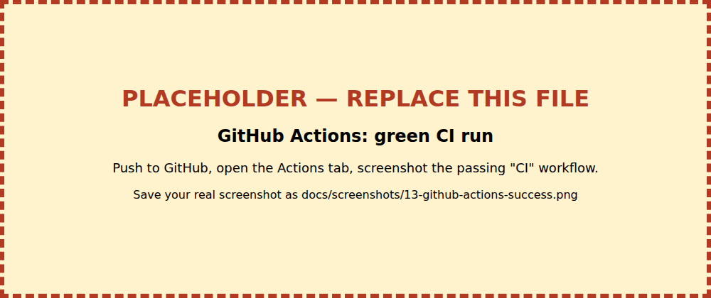

**Docker container running:**

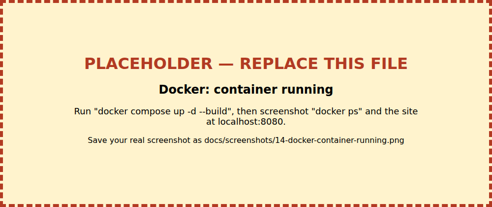

**Live deployment on GitHub Pages:**

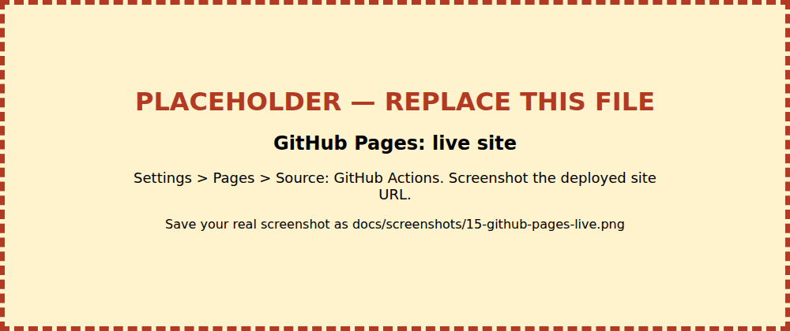

## Before you push

The commits are authored as `Your Name <you@example.com>`. To rewrite them as you:

```bash
git config user.name "Your Real Name" && git config user.email "you@github-email.com"
git rebase -r --root --exec "git commit --amend --reset-author --no-edit"
git remote add origin https://github.com/<you>/krishivision.git
git push -u origin main
```

See `docs/SUBMISSION_CHECKLIST.md` for the remaining steps.

## Future work

Replace the colour heuristic with a trained leaf-disease model (TensorFlow.js), add Marathi and Hindi, add more crops (grape, cotton, groundnut), and add offline support.

## License

MIT
